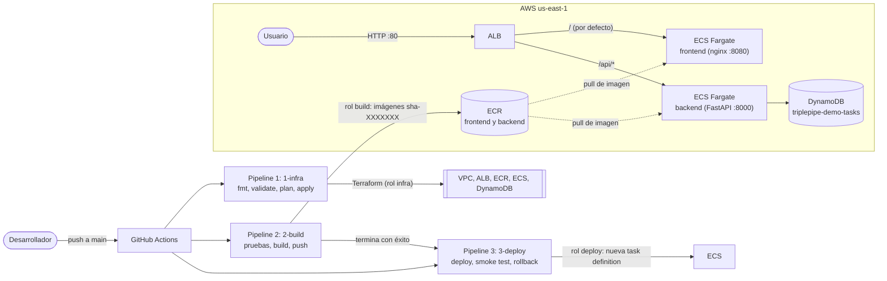

# Proyecto final DevOps: tres pipelines hacia AWS

Gestor de tareas (React + FastAPI + DynamoDB) desplegado en **ECS Fargate** detrás de un **ALB**, con tres
pipelines de **GitHub Actions** (infraestructura, build, despliegue) que se autentican en AWS por **OIDC**, sin
llaves estáticas. Toda la infraestructura está en Terraform.

> **Estado de la entrega:** el código, las pruebas locales y los scripts están listos, pero **el despliegue real
> en AWS todavía no se ha ejecutado**. La sección [Evidencia de la demo](#evidencia-de-la-demo) tiene marcadores
> `<!-- PENDIENTE -->` que se completan tras la primera ejecución.

## Arquitectura



Los tres pipelines usan roles IAM distintos (`infra`, `build`, `deploy`), cada uno con el mínimo privilegio.

## Estructura de carpetas

```text
aplicacion/          Backend (FastAPI), frontend (React + nginx), gateway local y docker-compose.yml
terraform/           Infraestructura raíz (módulos network, ecr, alb, ecs, data)
terraform/bootstrap/ Se ejecuta una vez a mano: bucket de estado, proveedor OIDC y los 3 roles
pipelines/           Definiciones canónicas de los workflows (workflows/), scripts Bash (scripts/) y pruebas (tests/)
.github/workflows/   Copia exacta de pipelines/workflows/ (la que GitHub ejecuta)
PLAN.md              Contrato técnico: nombres, puertos, variables y decisiones
```

**Por qué los workflows están en dos sitios.** El enunciado pide que las definiciones de los pipelines vivan en
`pipelines/`, pero GitHub solo ejecuta lo que está en `.github/workflows/`. La fuente canónica es
`pipelines/workflows/`; la copia se genera con `pipelines/scripts/sync-workflows.sh` y
`sync-workflows.sh --check` falla si difieren. Tras editar un workflow, vuelve a sincronizar.

## Requisitos

- Cuenta de AWS y credenciales locales de administrador (solo para el bootstrap), con la región `us-east-1`.
- **Reloj del sistema sincronizado** (NTP): AWS rechaza las peticiones firmadas con un desfase mayor de 15 minutos
  (`SignatureDoesNotMatch` / `RequestTimeTooSkewed`). Compruébalo antes de ejecutar `terraform` o `aws`.
- Terraform **>= 1.10** (por `use_lockfile`), AWS CLI v2, `jq`.
- GitHub CLI (`gh`) autenticada, y un repositorio propio en GitHub.
- Docker (con Compose) para la ejecución local; Node 22 y Python 3.12 solo si quieres probar sin Docker.

## Ejecución local con Docker Compose

```bash
cd aplicacion
docker compose up -d --build
# abrir http://localhost:8081
docker compose down
```

El `gateway` replica el ruteo del ALB (`/api/*` al backend, el resto al frontend). Sin `TASKS_TABLE` el backend guarda
las tareas en memoria; en AWS usa DynamoDB. Pruebas sueltas: `cd aplicacion/backend && python -m pytest` y
`cd aplicacion/frontend && npm ci && npm test && npm run build`. Pruebas de los scripts de despliegue (sin AWS
real): `pipelines/tests/run-tests.sh`.

## Reproducir la solución en AWS

1. **Bootstrap local (una vez).** Crea el bucket de estado, el proveedor OIDC y los 3 roles:
   ```bash
   cd terraform/bootstrap
   cp terraform.tfvars.example terraform.tfvars   # editar github_repository = "owner/repo"
   terraform init
   terraform plan -var github_repository=owner/repo   # revisar: solo recursos triplepipe-* y el proveedor OIDC
   terraform apply -var github_repository=owner/repo
   terraform output github_variables
   ```
   Si la cuenta ya tiene el proveedor OIDC de GitHub, usa `create_github_oidc_provider = false`. El estado local de
   `bootstrap/` no se versiona: conserva el archivo. Si el repo usa `sub` inmutable (repos nuevos de GitHub), añade
   `-var github_subject_prefix=...` (ver `terraform/bootstrap/terraform.tfvars.example`).
2. **Crear el repositorio en GitHub, todavía sin subir el código.** Así el primer `push` ya encuentra las variables:
   ```bash
   gh repo create owner/repo --public   # o --private
   ```
3. **Cargar las variables de GitHub** (no son secretos) desde las salidas del bootstrap:
   ```bash
   pipelines/scripts/configure-github-vars.sh owner/repo
   ```
   Carga `AWS_REGION`, `AWS_ROLE_INFRA`, `AWS_ROLE_BUILD`, `AWS_ROLE_DEPLOY`, `TF_STATE_BUCKET` y `PROJECT_PREFIX`.
4. **Crear el environment `production`** con tu usuario como revisor requerido (también se puede hacer en
   Settings > Environments). Los jobs `apply` (pipeline 1) y `deploy` (pipeline 3) esperan aquí tu aprobación:
   ```bash
   echo '{"reviewers":[{"type":"User","id":<TU_ID_NUMERICO>}]}' | \
     gh api -X PUT repos/owner/repo/environments/production --input -
   ```
5. **Subir el código a `main`** (`git init -b main`, `git add .`, `git commit`, `git remote add origin ...`, `git push -u origin main`).
   El primer commit lleva `[skip ci]` en el mensaje para no lanzar `2-build` antes de que existan los repos ECR
   (fallaría en el push de imágenes). Los pipelines se lanzan a propósito en los pasos siguientes.
6. **Pipeline 1, infraestructura.** Lánzalo a mano (`gh workflow run 1-infra.yml --ref main -f action=apply`), revisa el plan
   y aprueba el job `apply` (environment `production`). Al terminar,
   la URL del ALB responde 503: los servicios nacen con `desired_count = 0`.
7. **Pipeline 2, build.** Lanza `2-build` (*Run workflow*). Ejecuta pruebas, construye ambas imágenes,
   las etiqueta `sha-<7>` y las sube a ECR; el resumen del job lista las URIs.
8. **Pipeline 3, despliegue.** Arranca solo al terminar `2-build` con éxito; aprueba el job `deploy`. También se lanza
   a mano con `image_tag` (por ejemplo `sha-1a2b3c4`) para redesplegar o revertir.
9. **Abrir la aplicación.** La URL sale de `terraform output alb_url` (en `terraform/`), de
   `pipelines/scripts/alb-url.sh` (con credenciales y `AWS_REGION`/`PROJECT_PREFIX` definidos) o del ALB
   `triplepipe-demo-alb` en la consola. El pie de la página muestra la versión del frontend y del backend.

La ejecución manual de la infraestructura (sin pipeline) está en [`terraform/README.md`](terraform/README.md) y el detalle
de los pipelines en [`pipelines/README.md`](pipelines/README.md).

## Decisiones de arquitectura

| Decisión | Motivo |
|---|---|
| **Sin NAT**: VPC con 2 subredes públicas y tareas con IP pública | Un NAT cuesta ≈ $32/mes, injustificable en una demo. Las tareas solo aceptan tráfico del grupo de seguridad del ALB (8080 y 8000) y solo salen por 443. |
| **Ruteo en el ALB**: `/api/*` al backend, todo lo demás al frontend | Mismo origen para el navegador: no hace falta CORS y el frontend llama a rutas relativas. Health checks `/health` y `/api/health`. |
| **`desired_count = 0`** al crear los servicios, con `ignore_changes` en `task_definition` y `desired_count` | Rompe el ciclo huevo-gallina: al aplicar la infraestructura ECR está vacío. Terraform crea la estructura y el pipeline 3 es dueño de la versión en ejecución. |
| **Etiquetas inmutables** `sha-<7>`, sin `latest`, ECR `IMMUTABLE` | Trazabilidad exacta commit-imagen y rollback reproducible. Si la etiqueta ya existe, el build la omite sin fallar. |
| **DynamoDB** `PAY_PER_REQUEST` | Los datos sobreviven a un despliegue; el rol de tarea del backend solo tiene `GetItem/PutItem/UpdateItem/DeleteItem/Scan` sobre la tabla. |
| **Estado en S3** con `use_lockfile`, versionado y cifrado | Sin tabla DynamoDB de bloqueos. |
| **Scripts Bash** en `pipelines/scripts/` | Los YAML quedan delgados y la lógica se puede ejecutar y probar en local. |

## Credenciales

- **OIDC, sin secretos.** Ningún secreto de AWS está en GitHub ni en el repositorio: los workflows piden un token OIDC y
  asumen un rol. Las variables de GitHub (ARN de roles, bucket, región) no son secretos.
- **Tres roles**, uno por pipeline: `triplepipe-github-infra` (Terraform, acotado a `triplepipe-*`, sin
  `AdministratorAccess`), `triplepipe-github-build` (solo `ecr:GetAuthorizationToken` y push/lectura en los dos
  repos) y `triplepipe-github-deploy` (task definitions, `UpdateService`, lectura de ECR y `iam:PassRole` solo a los roles
  de ECS con `iam:PassedToService = ecs-tasks.amazonaws.com`).
- **Confianza acotada:** `aud = sts.amazonaws.com` y `sub` limitado al repositorio, a `ref:refs/heads/main` y a
  `environment:production`. Los `pull_request` solo hacen `fmt` y `validate`, sin rol.

## Manejo de errores

- **Circuit breaker de ECS** con rollback automático: si las tareas nuevas no llegan a estar sanas, ECS vuelve a la revisión anterior.
- **`deploy.sh`** falla con un mensaje claro si la imagen no existe en alguno de los dos repos, y guarda las revisiones previas.
- **`smoke-test.sh`** (con reintentos) comprueba `/`, `/api/health`, que `/api/version` y `/version.json` coincidan con la
  versión desplegada, y un CRUD completo sobre `/api/tasks` que limpia lo que crea.
- **`rollback.sh`**: si algo falla, el job vuelve a las revisiones guardadas y termina en rojo. En el primer despliegue
  (la revisión previa es `:bootstrap`) deja el servicio con `desired-count 0`.
- `destroy` exige escribir `triplepipe-demo` en `confirm`; los despliegues de producción exigen aprobación.

## Costos y destrucción

Con todo arriba cuesta ≈ **$0.07/hora** (ALB, 2 tareas Fargate mínimas, 4 IPv4 públicas), más unos centavos de logs y
ECR. Para no dejar gasto, **en este orden**:

1. **Pipeline 1 con `destroy`**: *Run workflow* en `1-infra`, `action = destroy`, `confirm = triplepipe-demo`, y aprobar el
   job `apply`. (Alternativa manual: `terraform destroy` en `terraform/`.) Los repos ECR usan `force_delete`.
2. **Después, `terraform/bootstrap`**: `terraform destroy`. Destruye el bucket que guarda el estado de la raíz, por eso va al
   final; como está versionado, puede que haya que vaciarlo a mano antes.

## Guion de demo (≈ 10 minutos)

1. **Contexto (1 min).** Mostrar el diagrama de este README y la estructura de carpetas (`pipelines/` frente a `.github/workflows/`).
2. **Pipeline 1 (2 min).** Ejecutar o mostrar una ejecución de `1-infra`: fmt, validate, plan como artefacto y aprobación del
   `apply`. Abrir la consola: VPC, ALB, clúster ECS, tabla DynamoDB.
3. **Pipeline 2 (2 min).** Ejecutar `2-build` con un cambio visible (por ejemplo un texto de la interfaz). Mostrar pruebas, el resumen
   con las URIs y, en **ECR**, las imágenes `sha-<7>` en ambos repos y el resultado del escaneo.
4. **Pipeline 3 (2 min).** Mostrar el despliegue automático con aprobación, `wait services-stable` y el smoke test.
5. **Comprobar la app (1 min).** Abrir la URL del ALB; el pie muestra la versión nueva en frontend y backend.
6. **Persistencia.** Crear una tarea, relanzar `3-deploy` y comprobar que la tarea sigue ahí (vive en DynamoDB, no en el contenedor).
7. **Rollback.** Lanzar `3-deploy` manualmente con `image_tag` de la versión anterior y ver cómo cambia el pie. Opcional:
   un despliegue con una etiqueta inexistente para enseñar el fallo claro de `deploy.sh`.
8. **Explicar (1 min).** Decisiones (sin NAT, rutas del ALB, `desired_count = 0`, etiquetas inmutables), credenciales
   (OIDC, 3 roles, sin secretos) y manejo de errores (circuit breaker, smoke test, `rollback.sh`).

## Evidencia de la demo

El despliegue real en AWS **todavía no se ha ejecutado**; estos datos se completan después de la primera ejecución.

- URL de la aplicación (ALB): <!-- PENDIENTE: URL del ALB -->
- Ejecución del pipeline 1 (`1-infra`): <!-- PENDIENTE: enlace a la ejecución -->
- Ejecución del pipeline 2 (`2-build`): <!-- PENDIENTE: enlace a la ejecución -->
- Ejecución del pipeline 3 (`3-deploy`): <!-- PENDIENTE: enlace a la ejecución -->
- Captura de ECR con las imágenes `sha-<7>`: <!-- PENDIENTE: captura -->
- Captura de la aplicación con las versiones en el pie: <!-- PENDIENTE: captura -->
- Evidencia de rollback (ejecución o captura): <!-- PENDIENTE: enlace o captura -->
- Enlace al vídeo de la demo, si aplica: <!-- PENDIENTE: enlace -->

## Limitaciones conocidas y mejoras

- **Solo HTTP:** no hay dominio, por tanto no hay TLS. Mejora: dominio en Route 53 y certificado de ACM con HTTPS.
- **Permisos del rol `infra` sin probar contra AWS real:** no se han ejecutado contra AWS real; la primera ejecución puede revelar permisos faltantes (error `AccessDenied`) que habrá que ajustar.
- Sin autenticación de usuarios, un solo ambiente y sin autoscaling.
- Sin NAT ni VPC endpoints (las tareas salen por IP pública), sin flow logs ni claves KMS propias, por costo.
- El primer commit usa `[skip ci]` para no disparar `2-build` antes de que exista ECR (ver paso 5).
